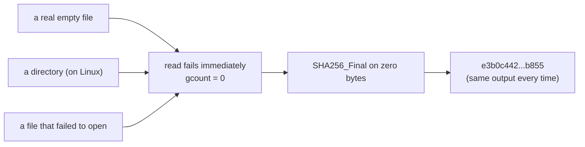

# FIM v0.2: Error Report (Non-Compile Errors)

> [!IMPORTANT]
> **Running is not the same as working.** The compiler only checks that your code is *well-formed*. It cannot check that the code does what you *meant*. Every item below compiles and runs, and every one of them is still a problem.

## 0. The Mental Shift

| Level | What happens | Who catches it |
|---|---|---|
| 1. Won't compile | Syntax or type error | The compiler |
| 2. Crashes or hangs | Program dies or never finishes | You, immediately (it is noisy) |
| 3. Runs, exits normally, **output is wrong** | Looks plausible, is incorrect | **Nobody, unless you test for it** |

"It ran" only rules out level 1. Level 3 is the dangerous one, and an integrity monitor that silently gives a wrong answer is worse than one that crashes, because you will trust it.

## Contents

1. [Summary](#1-summary)
2. [A: Silent wrong answers](#2-a-silent-wrong-answers)
3. [B: Crashes and hangs](#3-b-crashes-and-hangs)
4. [C: Silent failure and the lying exit code](#4-c-silent-failure-and-the-lying-exit-code)
5. [D: Works today, fragile later](#5-d-works-today-fragile-later)
6. [What is actually correct, and why](#6-what-is-actually-correct-and-why)
7. [Lab: reproduce each error](#7-lab-reproduce-each-error)
8. [Questions to ask of every function](#8-questions-to-ask-of-every-function)

---

## 1. Summary

| ID | Where | Problem | Severity |
|---|---|---|---|
| A1 | `main.cpp` | Directories are hashed as if they were empty files | High |
| A2 | `fim.cpp` | `hash_file()` cannot tell "failed" from "empty" | High |
| A3 | `fim.cpp` | Read loop hides I/O errors | Medium |
| A4 | `main.cpp` | Unreadable files are skipped with no message | High |
| B1 | `main.cpp` | Missing or unreadable directory aborts the program | Medium |
| B2 | `main.cpp` | A named pipe (FIFO) makes the program hang forever | Low |
| C1 | `main.cpp` | Manifest write failure is never detected | High |
| C2 | `main.cpp` | Always exits with `0`, even on failure | Medium |
| D1 | both | Text mode instead of binary | Medium |
| D2 | `main.cpp` | Path spelling differs between runs | Medium |
| D3 | `main.cpp` | Manifest lives inside the monitored directory | Medium |
| D4 | `main.cpp` | Target path hardcoded in two places | Low |
| D5 | `main.cpp` | Manifest line format is awkward to read back | Medium |
| D6 | `main.cpp` | Manifest existence checked *after* the work | Low |
| D7 | both | Hidden include dependency, dead code, double open | Low |

---

## 2. A: Silent wrong answers

### A1. Directories are hashed as if they were empty files

**Where:** `main.cpp`, inside the loop.

**What the code does.** You compute `ftype` for files and directories, but nothing ever *uses* it. Every entry continues down the loop. For a directory, `std::ifstream file(entry.path())` is expected to **succeed on Linux**, because the operating system lets you open a directory for reading. The failure only comes when you try to *read*. So `if (!file)` is false and the loop carries on into `hash_file()`.

Inside `hash_file()` the first `read()` fails at once and `gcount()` is `0`. The `while` body never runs, so `SHA256_Update` is never called. `SHA256_Final` then returns the hash of **zero bytes**.

**Why it matters.** Your baseline gets an entry for every subfolder, with a fake hash:

```text
e3b0c44298fc1c149afbf4c8996fb92427ae41e4649b934ca495991b7852b855
```

That is the *correct* hash for a genuinely empty file. So the same hash now means two different things, and you can't tell them apart later.

**You would see:** a manifest line for `./protected/sub` that has a hash. A directory has no content to hash.

**Fix idea:** make the decision you already computed.

```cpp
if (!entry.is_regular_file()) continue;   // first line in the loop
```

> [!NOTE]
> If Experiment A1 below shows no `sub` line, your standard library refuses to open directories and A1 does not apply to you. A2 still does.

### A2. `hash_file()` cannot tell "failed" from "empty"

**Where:** `fim.cpp`, where your own comment says to add error handling.

If the file fails to open, `read()` fails immediately, `gcount()` is `0`, and you get the hash of zero bytes. **Several different situations all produce one identical answer:**



**The lesson:** when different situations collapse into the same output, information has been destroyed. The caller can no longer ask "did this work?". A function that can fail needs a way to say so, either by throwing an exception or by returning something that can mean "no result" (such as `std::optional`).

Also: `SHA256_Init/Update/Final` return `1` on success, and you ignore the return values. If one failed, `md` could hold garbage and nobody would know. Failure is very unlikely, but you are not checking.

### A3. The read loop hides I/O errors

**Where:** `fim.cpp`, the `while` loop.

```cpp
while (file.read(buffer.data(), buffer.size()) || file.gcount() > 0)
```

The loop stops when there is nothing more to read, but there are **two very different reasons** it can stop:

| Reason | Stream flag | Meaning |
|---|---|---|
| Reached the end of the file | `eof()` | Normal, hash is complete |
| Read error partway through | `bad()` | Hash covers only part of the file |

Your code treats both the same. After a mid-file error you would return the hash of *only the part that was read*, as though it were the whole file. This is rare (failing disks, flaky network mounts), but those are exactly the situations where an integrity tool must not guess.

**Fix idea:** after the loop, check `file.bad()` before trusting the result.

### A4. Unreadable files are skipped silently

**Where:** `main.cpp`.

```cpp
std::ifstream file(entry.path());
if (!file) { continue; }
```

If a file cannot be opened (for example, permission denied), `continue` skips it. **Nothing is printed.** The baseline is simply missing that file and no one is told.

For a file integrity monitor this is backwards. A file you cannot read is exactly the kind of thing you should be told about. What the program does about it is your decision (warn, abort, record it as unreadable), but doing nothing is not a policy.

---

## 3. B: Crashes and hangs

### B1. Missing or unreadable directory aborts the program

**Where:** `main.cpp`, the `recursive_directory_iterator(target)` line.

If `./protected` does not exist, the iterator **throws** `std::filesystem::filesystem_error`. You have no `try/catch`, so the exception travels up through `main()`, `std::terminate` is called, and the program aborts:

```text
terminate called after throwing an instance of 'std::filesystem::__cxx11::filesystem_error'
  what():  filesystem error: directory iterator cannot open directory: No such file or directory [./protected]
Aborted
```

The same thing happens **mid-traversal** if it reaches a subdirectory it has no permission to enter. Because the manifest is written only *after* the loop, a crash partway through leaves you with no manifest at all.

> [!TIP]
> There are two styles of error reporting in `<filesystem>`: functions that throw exceptions (what you are using), and overloads that take a `std::error_code&` and report the error without throwing. The iterator also accepts `std::filesystem::directory_options::skip_permission_denied` if you want to skip folders you can't enter.

### B2. A named pipe makes the program hang

**Where:** `main.cpp`, `std::ifstream file(entry.path())`.

If the monitored folder contains a **FIFO** (named pipe), opening it for reading blocks until some other program opens the other end. Nothing does, so the program **hangs forever** with no output.

It is an unusual case, but the underlying lesson is not: `std::ifstream` will try to open *anything* you hand it. Only regular files are safe to read this way, which is another reason for the `is_regular_file()` filter in A1.

---

## 4. C: Silent failure and the lying exit code

### C1. Manifest write failure is never detected

**Where:** `main.cpp`.

```cpp
std::ofstream manifest("./protected/manifest.txt");
manifest << ...
```

If the stream failed to open (read-only folder, no permission), every `<<` is **silently ignored**. Writes to a failed stream do nothing and raise no error. The program prints nothing, reports no problem, and no manifest exists. The same happens if the disk fills halfway through: you get a truncated baseline.

**Fix idea:** check `if (!manifest)` right after opening, and again after writing.

### C2. The program always exits with `0`

**Where:** `main.cpp`, `return 0;`.

By Unix convention, exit code `0` means **success** and anything else means failure. Your program returns `0` even when:

- the manifest already existed and nothing was written
- the manifest could not be written (C1)
- files were skipped (A4)

Anything that runs your program (a shell script, a scheduler, `&&` chaining) will believe it succeeded.

```bash
./fim && echo "baseline created"     # prints even when nothing was created
```

---

## 5. D: Works today, fragile later

### D1. Text mode instead of binary

**Where:** both `ifstream` constructions, but `hash_file()` is the one that matters.

On Linux, text mode and binary mode behave identically, so you will never see a problem. On Windows, text mode translates `\r\n` to `\n` and treats a `0x1A` byte as end-of-file. The hash would then not describe the bytes on disk, and two files that differ only in line endings could hash identically. Use `std::ios::binary` so the code does not depend on the operating system.

### D2. Path spelling differs between runs

**Where:** `hash_path_map[entry.path()]`.

The map key is whatever the iterator produces, which depends on how `target` was written:

| Target given as | Key produced |
|---|---|
| `./protected` | `./protected/a.txt` |
| `protected` | `protected/a.txt` |
| `/home/me/protected` | `/home/me/protected/a.txt` |

Those are three different keys for the **same file**. Today `target` is hardcoded, so you never see this. The moment the target comes from the command line, a baseline made with one spelling won't match a later run that uses another.

### D3. Manifest lives inside the monitored directory

**Where:** `main.cpp`, `./protected/manifest.txt`.

It happens to be written *after* the traversal, so on the first run it is not hashed. But on every later run the file exists, so the traversal **does** hash it (and the result is thrown away). The manifest is also a file in the monitored folder that is not in its own baseline. Once you add comparison, it will look like an unexpected file. Storing the baseline outside the monitored tree avoids all of this.

### D4. Target path hardcoded in two places

```cpp
std::filesystem::path target = "./protected";
...
std::filesystem::exists("./protected/manifest.txt")
```

These two strings must agree, but nothing makes them agree. Change one and the other silently keeps pointing at the old location. Build the manifest path *from* `target` so there is one source of truth.

### D5. Manifest line format is awkward to read back

**Where:** `main.cpp`.

```cpp
manifest << " [PATH] : " << key << " [HEX] : " << value << '\n';
```

Two surprises:

- Streaming a `std::filesystem::path` writes it **in quotes**, with `"` and `\` escaped by a backslash. So a file named `a"b` is stored as `"./protected/a\"b"`. The line is not a plain copy of the path, and reading it back needs un-escaping. `key.string()` gives the raw text.
- The file also has a header line and a footer line. Anything that reads it later must know to skip them, and must not mistake them for data.

### D6. Manifest existence checked after the work

**Where:** `main.cpp`.

The whole directory is traversed and every file is hashed, and only *afterwards* does the code check whether a manifest already exists. If it does, all that work is discarded. The cheap check belongs first.

### D7. Hidden dependency, dead code, double open

- **Hidden include dependency.** `main.cpp` includes only `fim/fim.hpp` and `<map>`, yet uses `std::cout`, `std::ifstream`, `std::array`, `std::string` and `std::filesystem`. It compiles only because `fim.hpp` (which I haven't seen) pulls those in. Trim that header and `main.cpp` breaks. Each file should include what it uses.
- **Dead code.** `ftype` is set but never read. `BUFFER_SIZE` in `main.cpp` and `target` inside `hash_file()` are unused.
- **Two opens per file.** `main()` opens each file to test it, then `hash_file()` opens it again. Between the two opens the file could change. The error handling belongs inside `hash_file()`, in one place.

---

## 6. What is actually correct, and why

Knowing what is *right* matters as much as finding what is wrong.

**The read loop ends correctly.**
After the final partial read, the stream's end-of-file and fail flags are set. The next `read()` fails immediately and **resets `gcount()` to 0**, so `|| file.gcount() > 0` is false and the loop exits. No infinite loop and no stale bytes.

**The SHA-256 context is per file.**
`SHA256_Init` runs inside `hash_file()`, so each call starts from a fresh state. Files cannot leak into each other's hashes.

**The hex conversion is correct, but only because of `unsigned char`.**
`bytes[i] >> 4` is safe because `bytes[i]` is *unsigned*, so the result is always `0` to `15`. If the type were plain `char`, a byte like `0xA7` is stored as `-89`, and `-89 >> 4` is `-6`. Then `hex_chars[-6]` reads memory **before** the start of the table. That would be a real bug with no compile error and sometimes no visible symptom. If you ever change the digest type, this is what breaks.

---

## 7. Lab: reproduce each error

Use a scratch folder so your real project is untouched. Assumes Linux and a normal user account (**not root**, because root ignores file permissions).

```bash
mkdir -p /tmp/fim-lab/protected/sub && cd /tmp/fim-lab
echo "hello" > protected/a.txt
touch protected/empty.txt
echo "deep"  > protected/sub/c.txt
FIM=/full/path/to/your/build/fim        # edit this
```

**A1: directory gets a hash**

```bash
rm -f protected/manifest.txt; $FIM
grep -i e3b0c442 protected/manifest.txt
```

Expect two lines: `empty.txt` (legitimate) and `sub` (the bug). Same hash, different meaning.

**Cross-check against a trusted tool** (compare ignoring upper/lower case):

```bash
sha256sum protected/a.txt protected/sub/c.txt
cat protected/manifest.txt
```

**A4: unreadable file skipped silently**

```bash
rm -f protected/manifest.txt
chmod 000 protected/a.txt; $FIM; echo "exit: $?"
cat protected/manifest.txt              # a.txt is missing, and nothing told you
chmod 644 protected/a.txt
```

**B1: missing directory, then unreadable subdirectory**

```bash
mv protected protected_gone; $FIM; echo "exit: $?"; mv protected_gone protected

rm -f protected/manifest.txt
chmod 000 protected/sub; $FIM; echo "exit: $?"
ls protected/manifest.txt               # no manifest at all
chmod 755 protected/sub
```

**B2: FIFO hang**

```bash
mkfifo protected/pipe; rm -f protected/manifest.txt
$FIM                                    # hangs; press Ctrl+C
rm protected/pipe
```

**C1: manifest write fails silently**

```bash
rm -f protected/manifest.txt
chmod 555 protected; $FIM; echo "exit: $?"
ls protected/manifest.txt               # doesn't exist, and the program said nothing
chmod 755 protected
```

**C2: exit code lies**

```bash
rm -f protected/manifest.txt; $FIM; $FIM; echo "exit: $?"
# second run prints "Manifest already exists!" and still exits 0
```

---

## 8. Questions to ask of every function

1. **What are all the ways this can fail**, and what does my code return in each case?
2. **Can two different situations produce the same output?** If yes, information is being lost.
3. **If it fails, will anyone be told?** A silent `continue` or an unchecked stream says nothing.
4. **What does a loop's exit mean?** Success, end of data, or an error?
5. **What am I assuming about the environment?** Operating system, permissions, working directory, how the path was typed.
6. **Have I checked the output against an independent source**, like `sha256sum`, rather than just seeing that it printed something?
7. **What are the hostile inputs?** Empty, missing, unreadable, huge, a directory, something that isn't a file.

> [!NOTE]
> **What tools can and can't catch.** Compiler warnings (`-Wall -Wextra`) will flag unused variables like `target` and `ftype`. Sanitizers (`-fsanitize=address,undefined`) catch memory bugs such as the signed-`char` index in section 6. **None of A to D is something a compiler or sanitizer will find.** They are logic and design errors, and only hostile test inputs plus cross-checking against a trusted tool expose them.
